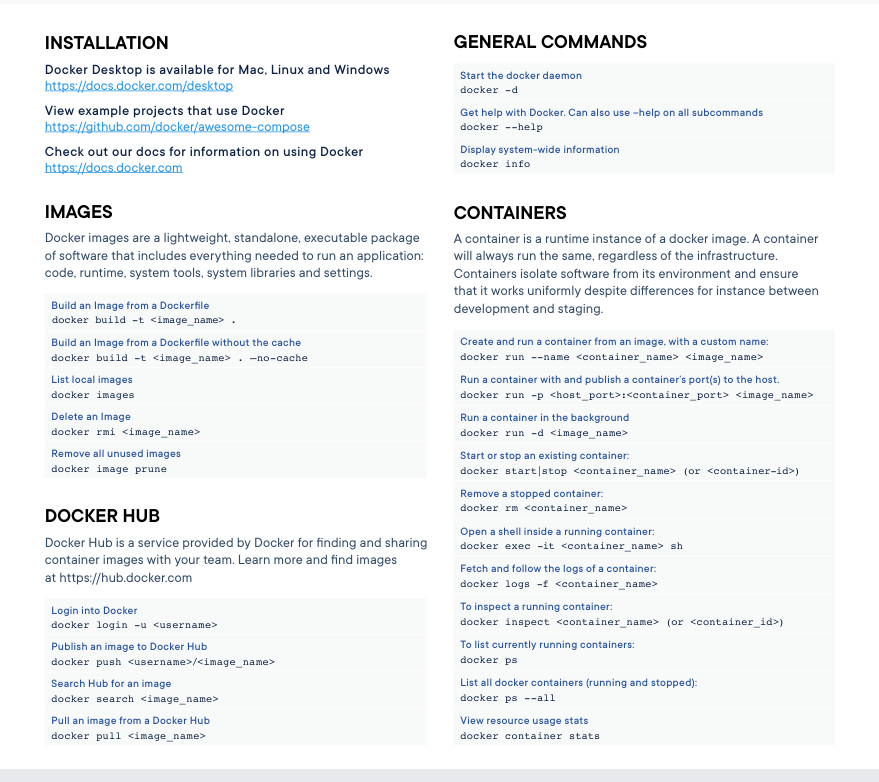
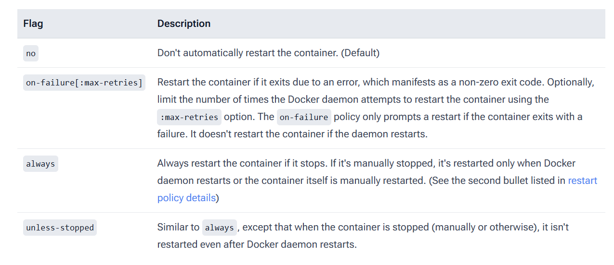

# Instal·lació de MySQL amb un contenidor de Docker
Podem instal·lar MySQL mitjançant la imatge oficial que es troba a Docker Hub.

Primerament haurem d'instal·lar Docker al nostre sistema operatiu. La següent instrucció instal·la Docker a una distribució Ubuntu de Linux.

    $ sudo apt install docker.io

Ens baixarem la imatge de MySQL de l'última versió LTS (9.7).

    $ sudo docker pull mysql:9.7

Posteriorment podem crear i executar un contenidor basat a eixa imatge.

    $ sudo docker run --name {nom_contenidor} -e MYSQL_ROOT_PASSWORD={password_usuari} -d mysql:9.7

A l'anterior instrucció em de donar un nom al contenidor amb el paràmetre `--name` i donem valor a la variable d'entorn `MYSQL_ROOT_PASSWORD` amb el paràmetre `-e`.

Amb el paràmetre `-d` s'executa el contenidor en segon pla, mentre que finalment es troba el nom de la imatge base del contenidor.

Podem accedir a l'interior del contenidor i executar un terminal en ell. El pàrametre `-it` permet obrir un terminal interactiu.

    $ sudo docker exec -it {nom_contenidor} bash

Ja dins del contenidor podem executar el client **mysql** de la manera habitual.

    $ mysql -u root -p

## Accés a MySQL des de l'exterior del contenidor
Per defecte tots els serveis del contenidor de Docker estan aïllats de l'exterior. Si volem accedir des de fora del contenidor als serveis haurem de mapejar el port del servei del contenidor a un port del host local amb el paràmetre `-p`. 

No podem canviar el paràmetres de llançament d'un contenidor prèviament creat així que si volem utilitzar el mateix nom de contenidor, abans l'aturarem si estava en marxa i el destruirem.

    $ sudo docker stop {nom_contenidor}
    $ sudo docker rm {nom_contenidor}


Sabent que el port de MySQL és el **3306**, el següent exemple el mapeja al port del host **3307**. No cal que el port del host siga distint al del contenidor (sempre i quan no estiga ocupat per un altre servei). En aquest exemple sí que és distint per clarificar en quin ordre s'escriu el port del host i el del contenidor.

    $ sudo docker run --name {nom_contenidor} -e MYSQL_ROOT_PASSWORD={password_usuari} -p 3307:3306 -d mysql:9.7

D'aquesta manera podriem tindre diversos contenidor de MySQL mapejats a distints ports i inclós de diferents versions.

Si volem accedir amb el client de mysql haurem d'especificar explícitament la direcció IP on es troba el servidor (encara que siga al mateix equip) amb el paràmetre `-h`. Si havíem canviat el port per defecte de MySQL també haurem d'especificar-lo amb el paràmetre `-P`.

    $ mysql -h 127.0.0.1 -P 3307 -u root -p

La següent imatge mostra un llistat d'instruccions bàsiques de Docker:

<figure style="align: center;">
    
    <figcaption>Docker Cheat Sheet</figcaption>
</figure>

Per defecte els contenidors no es reinicien automàticament una vegada s'aturen. Podem configurar que es reinicien quan s'aturen amb el paràmetre `--restart`. La següent imatge mostra els valors possibles del paràmetre:

<figure style="align: center;">
    
    <figcaption>Polítiques de reinici de contenidors Docker</figcaption>
</figure>

La següent instrucció crea i llança un contenidor perquè es reinicie automàticament si hi ha una aturada accidental del contenidor. Si s'atura manualment només quan es reinicie Docker es reiniciarà el contenidor.

    $ sudo docker run --name {nom_contenidor} -e MYSQL_ROOT_PASSWORD={password_usuari} -p 3307:3306 --restart always -d mysql:9.7

## Desplegament amb Docker Compose

Tot i que l'ús de la línia de comandes de Docker run és útil per a proves ràpides, quan necessitem configurar escenaris més complexos o assegurar-nos que els paràmetres de llançament siguen sempre els mateixos (com per exemple en entorns de laboratori), és molt més eficient utilitzar Docker Compose. 

Docker Compose permet definir i gestionar contenidors mitjançant un fitxer de text en format YAML (habitualment anomenat `compose.yaml` o `docker-compose.yml`). D'aquesta manera, tota la configuració queda documentada i es pot versionar. En Ubuntu hauràs d'instal·lar el paquet `docker-compose-v2`.

A continuació mostrem un exemple d'arxiu compose.yaml que llança MySQL, mapeja els ports i configura dos volums: un per a salvaguardar les dades i un altre per poder afegir fitxers de configuració personalitzats.

```yaml
services:
  mysql_server:
    image: mysql:9.7
    container_name: {nom_contenidor}
    environment:
      MYSQL_ROOT_PASSWORD: {password_usuari}
    ports:
      - "3307:3306"
    restart: always
```

A continuació una llista d'alguns comandaments de `docker compose`:

- `docker compose up -d:` Construeix (si és necessari), crea, inicia i connecta els contenidors en segon pla deixant la terminal lliure.

- `docker compose down`: Atura i elimina els contenidors. Si s'afegeix el paràmetre `-v` (`docker compose down -v`), també elimina els volums associats perdent les dades persistents.

- `docker compose start`: Inicia els contenidors del projecte que ja estaven creats però estaven aturats.

- `docker compose stop`: Atura els contenidors en execució sense destruir-los ni alterar la seua configuració interna.

- `docker compose restart`: Reinicia els contenidors del projecte actual.

- `docker compose ps`: Mostra una llista dels contenidors gestionats per l'arxiu YAML actual, indicant el seu estat i els ports mapejats.

## Volums
Els contenidors són efímers per naturalesa. Això vol dir que si aturem i esborrem el contenidor (amb `docker rm`), es perden totes les modificacions realitzades al seu interior, incloses les bases de dades i les taules que havíem creat.

Per a fer que les dades siguen persistents, s'utilitzen els volums, que permeten enllaçar (mapejar) un directori de la nostra màquina amfitriona (el host) amb un directori de l'interior del contenidor. 

A continuació es mostra una versió ampliada de l'anterior exemple, amb 2 volums: un per als directoris de configuració de MySQL y l'altre per al directori on es troben les dades emmagatzemades a MySQL.

```yaml
services:
  mysql_server:
    image: mysql:9.7
    container_name: {nom_contenidor}
    environment:
      MYSQL_ROOT_PASSWORD: {password_usuari}
    ports:
      - "3307:3306"
    restart: always
    volumes:
      # Volum per a les dades de les BD
      - ./dades_mysql:/var/lib/mysql
      # Volum per a fitxers de configuració de MySQL
      - ./conf_mysql:/etc/mysql/conf.d
```

## Inicialització automàtica de la base de dades (Entrypoint)

Una característica molt potent de la imatge oficial de MySQL (que també utilitzen com a estàndard altres sistemes com PostgreSQL o MariaDB) és la capacitat d'executar automàticament scripts durant el primer arrancament del contenidor.

Això s'aconsegueix gràcies a l'Entrypoint (el procés d'inici) del contenidor, que està programat per cercar i executar qualsevol script situat a la ruta interna `/docker-entrypoint-initdb.d/`.

Per a utilitzar-ho, només cal mapejar un directori local que continga els nostres scripts a eixa ruta mitjançant un nou volum al fitxer compose.yaml:

```yaml
volumes:
      # Volum per a l'auto-inicialització
      - ./init_scripts:/docker-entrypoint-initdb.d
```

El contenidor processarà els arxius d'aquesta carpeta seguint un estricte ordre alfabètic. Per això, és una convenció molt recomanable afegir prefixos numèrics als arxius per assegurar l'ordre lògic d'execució (per exemple, primer crear l'esquema i després inserir les dades).

Els formats d'arxiu suportats són:

- `.sql`: Arxius de text pla amb instruccions SQL.
- `.sql.gz`: Arxius SQL comprimits amb gzip. El contenidor els descomprimeix i executa al vol, sent ideal per a estalviar espai quan movem grans volums de dades.
- `.sh`: Scripts de terminal (Bash) per a tasques més avançades d'inicialització.

Aquest procés d'importació automàtica només s'executa la primera vegada que s'engega el contenidor, és a dir, quan detecta que la carpeta de dades del sistema (`/var/lib/mysql`) està completament buida. Si el contenidor es reinicia o ja té dades creades prèviament, ignorarà el contingut d'aquesta carpeta per motius de seguretat.

## Exercici
Criteris d'avaluació 1f, 1g, 1h, 1i, 1j.

**Instal·lació de MySQL amb Docker**

- Instal·la MySQL 8.4 a la instància EC2 de l'anterior exercici. Recorda mapejar el servei del contenidor a un port distint del 3306 perquè no entre en conflicte amb l'anterior servidor instal·lat.
- Importa les BD **world** i **sakila** i comprova que les dades es creen correctament.

**Persistència i gestió amb Docker Compose**

- Crea un directori nou al teu sistema i crea un fitxer `compose.yaml` per a desplegar un servidor MySQL 8.4.
- Configura l'arxiu YAML per mapejar el servei a un port lliure (per exemple, 3307) i defineix un volum local mapejat a la ruta interna `/var/lib/mysql`.
- Llança l'entorn en segon pla utilitzant `docker compose up -d`.
- Connecta't al nou contenidor (recorda utilitzar el nou port) i crea una base de dades de prova amb algunes dades (o importa novament la BD **world**).
- Atura i elimina el contenidor executant `docker compose down`.
- Torna a llançar el contenidor amb `docker compose up -d` i comprova mitjançant el client de MySQL que la base de dades i les dades segueixen intactes gràcies al volum creat.

**Auto-inicialització de bases de dades**

- Crea una carpeta anomenada init_scripts al mateix directori on tens el teu fitxer compose.yaml.
- Copia l'arxiu world.sql dins d'aquesta nova carpeta i canvia-li el nom a `01_world.sql` seguint les bones pràctiques d'ordenació.
- Fes ho mateix amb els de sakila.
- Edita el fitxer compose.yaml per afegir el nou mapeig de volums cap a `/docker-entrypoint-initdb.d`.
- Com que l'script només s'executa si la base de dades és nova, atura i destrueix el contenidor actual (`docker compose down`). Després, elimina el directori del host on estan les dades de les BD de MySQL.
- Llança de nou l'entorn amb `docker compose up -d`.
- Revisa els registres d'arrancada executant `docker compose logs -f`. Hauries de vore missatges indicant que s'està processant els arxius `sql`.
- Connecta't amb el client de MySQL al port corresponent i verifica que estan les BD amb les seues dades.

