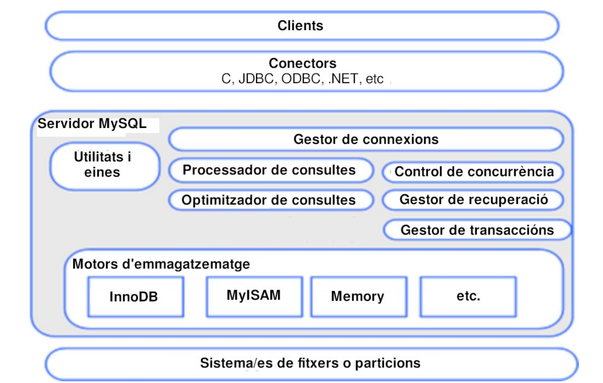
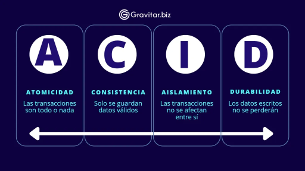

# Característiques de MySQL
Aquest SGBD és compatible amb **diverses plataformes**, incloent Linux, Windows o MacOS, la qual cosa el fa molt versàtil i adaptat a diferents entorns de treball. Una de les seues característiques principals és que és **multithread**, el que significa que pot executar múltiples fils d'execució simultanis i aprofitar la potència de sistemes amb diversos processadors, millorant així el seu rendiment en escenaris complexos.

Té 2 versions: la **Community Edition** de codi obert i l'**Enterprise Edition**, propietària amb funcions addicionals.

Un altre punt fort d'aquest sistema és que ofereix una varietat de **motors d'emmagatzematge**, la qual cosa permet als usuaris triar el que millor s'adapte a les seues necessitats. Alguns d'aquests motors tenen suport transaccional, la qual cosa garanteix la integritat de les dades, mentre que altres motors, sense aquesta capacitat, poden ser més lleugers i eficients per a certs tipus d'aplicacions.

Compta amb un ampli suport per a l'estàndard **SQL**, cosa que facilita la seua adopció en diferents projectes i entorns. 

Les **opcions de connexió** són nombroses, incloent PHP, ODBC, sockets TCP/IP, JDBC i API per a C/C++, fet que proporciona flexibilitat en la integració amb altres aplicacions o serveis.

Cal destacar que ofereix suport per a diversos **idiomes**. També es caracteritza per la seua **facilitat** d'instal·lació, ús i administració.

## Arquitectura MySQL
La següent figura mostra una visió lògica de l'arquitectura de MySQL.

<figure style="align: center;">
    
    <figcaption>Arquitectura de MySQL</figcaption>
</figure>

Els **connectors** (JDBC, ODBC...) de MySQL són els drivers que utilitzen els programes client per a connectar-se al servidor.

Les **utilitats i eines** són els programes i aplicacions que s'inclouen amb la distribució del gestor o que poden 
instal·lar-se com a aplicacions addicionals com eines de còpia de seguretat, aplicacions administratives d'interfície gráfica o
eines de disseny workbench.

El **gestor de connexions** és el responsable de mantenir les múltiples connexions dels clients. Si no existira el gestor de connexions es crearia una connexió per cada client connectat fent que es consumisquen recursos en la màquina. Crear aquestes connexions i destruir-les és un procés costós. Per això el gestor de connexions pot limitar connexions concurrents i també 
implementa un pool de connexions.

Quan una consulta arriba al **processador de consultes**, s'analitza detalladament i es produeix una representació intermèdia de la mateixa, posteriorment MySQL pren una sèrie de decisions que pot incloure el determinar l'ordre de lectura de les taules, l'ús de certs indexes o la re-escriptura de la consulta d'una forma més eficient. 

MySQL utilitza un **optimitzador** basat en costos per a determinar la millor manera de resoldre una consulta. En molts casos MySQL pot calcular el millor pla de consulta possible, però altres vegades MySQL no té suficient informació i ha de fer suposicions sobre les dades.

En versions anteriors, MySQL va utilitzar una **memòria cau** de consultes interna per veure si podia servir els resultats des d'allà. A mesura que va augmentar la concurrència, la memòria cau de consultes es va convertir en un coll de botella. A partir de MySQL 5.7.20, la memòria cau de consultes estava oficialment obsoleta i, a la versió 8.0, la memòria cau de consultes s'eliminà completament. Encara que la memòria cau de consultes ja no forma part del servidor MySQL, és una bona pràctica utilitzar una memòria cau dels conjunts de resultats més freqüents, utitlitzant SGBD clau-valor com **memcached** o **Redis**.

El **control de concurrència** és el mecanisme que s'utilitza per a evitar que lectures o escriptures simultànies a la mateixa 
porció de dades acaben en inconsistències o efectes no desitjats. El mecanisme que s'utilitza per a controlar aquest accés és el dels
bloquejos.

La **gestió de recuperació** és el mecanisme que proporciona MySQL per a poder recuperar-se en el cas que es produïsquen errors que anaren a deixar les dades en un estat incosistent.

Una **transacció** és un conjunt d'ordres que s'executen formant una unitat de treball, és a dir, en forma indivisible o atòmica. 
Un SGBD es diu transaccional si és capaç de mantenir la integritat de dades, fent que aquestes transaccions no puguen finalitzar en 
un estat intermedi. Quan per alguna causa el sistema ha de cancel·lar la transacció, comença a desfer les ordres executades fins a deixar la base de dades en el seu estat inicial (anomenat punt d'integritat), com si l'ordre de la transacció mai s'haguera realitzat. Una transacció ha de comptar amb **ACID** (un acrònim anglès) que vol dir: **Atomicitat**, **Consistència**, **Aïllament** (Isolation) i **Durabilitat**. 

<figure style="align: center;">
    
    <figcaption>ACID</figcaption>
</figure>

Els **motors d'emmagatzematge** són els responsables d'emmagatzemar i recuperar totes les dades emmagatzemades a MySQL. Igual que els diferents sistemes de fitxers disponibles per a Linux, cada motor d'emmagatzematge té els seus propis avantatges i inconvenients. El servidor es comunica amb ells mitjançant l'API del motor d'emmagatzematge. Aquesta API amaga les diferències entre els motors d'emmagatzematge i les fa molt transparents a la capa de consulta. També conté un parell de dotzenes de funcions de baix nivell que realitzen operacions com ara "iniciar una transacció" o "obtenir la fila que té aquesta clau primària". Els motors d'emmagatzematge no analitzen SQL ni es comuniquen entre ells; simplement responen a les peticions del servidor.

## Forks de MySQL
Com que el codi font de MySQL és obert i gratuït, existeixen nous projectes poden bifurcar el codi sense el permís del seu creador original. Fem una ullada a algunes de les bifurcacions més destacades.

### MySQL Community Edition
MySQL Community Edition, també coneguda com la versió upstream o vainilla de MySQL, és la versió de codi obert distribuïda per Oracle. Aquesta versió impulsa el desenvolupament del motor InnoDB i de noves funcions, i és la primera que rep actualitzacions, noves funcions i correccions d'errors.

### MySQL Enterprise Edition
MySQL Enterprise Edition és una versió amb llicència comercial (la qual cosa significa que cal pagar per utilitzar-la, com una llicència de Windows). També distribuït per Oracle, conté totes les funcionalitats de l'edició comunitària més funcions exclusives de seguretat, còpia de seguretat i alta disponibilitat.

### Percona Server for MySQL
La distribució Percona de MySQL és un reemplaçament gratuït i de codi obert de MySQL Community Edition. El desenvolupament segueix de prop aquesta versió, centrant-se a millorar el rendiment i l'ecosistema global de MySQL. Percona Server també inclou millores addicionals com el motor MyRocks, un connector de registre d'auditoria i un connector d'autenticació PAM.

### MariaDB Server
MariaDB Server és, amb diferència, la bifurcació que s'ha allunyat més de MySQL de vainilla. En els darrers anys ha desenvolupat noves funcions i motors com el MariaDB ColumnStore, i va ser la primera base de dades a integrar la funcionalitat de clúster de Galera 4.

## Exercici
Criteris d'avaluació 1a, 1b, 1c, 1d, 1e.

- Imagina que a l'exercici de l'anterior apartat triares MySQL com a RDBMS per al vostre projecte. Realitza un xicotet estudi de quina versió/fork seria més adequada: popularitat, facilitat d'instal·lació, preu, suport d'actualitzacions/estabilitat, confiança amb el projecte...