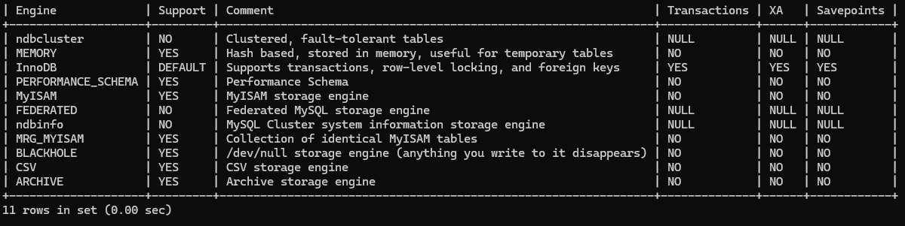

# Motors d'emmagatzematge
Una de les característiques de MySQL és el seu suport per a diferents motors d'emmagatzematge. A continuació veurem una visió general de quins motors hi ha disponibles, per què és possible que vulgueu utilitzar un motor no predeterminat i per què és important tenir aquesta opció.

En termes molt simplificats, MySQL us permet crear tipus distints de taules, els quals utilitzen distints motors d'emmgatzematge. Cada tipus ofereix a aquestes taules propietats diferents. No hi ha cap tipus de taula universalment bo, ja que cada motor d'emmagatzematge té pros i contres.

Les taules utilitzen de manera predeterminada el motor d'emmagatzematge **InnoDB**. A la majoria de les situacions utilitzarem este motor ja que en línies generals és ràpid, fiable i està ben provat i recolzat, i es considera àmpliament (inclòs per nosaltres) que ofereix el millor equilibri de pros i contres. Aquest motor s'utilitza amb èxit per aplicacions que requereixen molt alt rendiment de consultes curtes, i també per aplicacions de magatzem de dades que executen poques consultes de major mida.

A la versió 8.4 MySQL proporciona 8 motors d'emmagatzematge. Pots mostrar-los amb la següent instrucció:

    SHOW ENGINES;

<figure style="align: center;">
    
    <figcaption>Comandament SHOW ENGINES</figcaption>
</figure>

Per a seleccionar el motor d'emmagatzematge d'una taula:

    CREATE TABLE nom_taula (definició) ENGINE = nom_motor; 
    ALTER TABLE nom_taula ENGINE = nom_motor;

Exemples

    CREATE TABLE una_taula (...) ENGINE=InnoDB;
    ALTER TABLE una_taula ENGINE=MyISAM;

Per a consultar el motor utilitzat per una taula en concret:

    SHOW CREATE TABLE una_taula;

Podem utilitzar la variable **disabled_storage_engines** per definir quins motors d'emmagatzematge no es poden utilitzar per crear taules o espais de taula. Per defecte està buit (no hi ha motors desactivats), però es pot establir en una llista separada per 
comes d’un o més motors.

    [mysqld]
    disabled_storage_engines="MyISAM,BLACKHOLE,FEDERATED,ARCHIVE"

## InnoDB
InnoDB és fiable, eficient i amb totes les funcions. Gairebé tot el que espereu d'un RDBMS modern es pot aconseguir d'alguna manera amb InnoDB. Les dades es guarden en disc: un fitxer per a la definició de la taula, i un "tablespace" per a guardar conjuntament dades i índexs. El tablespace pot consistir en un o més fitxers, o fins i tot una partició sencera en disc.

El tipus de taula InnoDB inclou les característiques següents:

- **Suport a les transaccions**.  (ACID – Atomicidad, Consistència, Aïllament i Durabilitat).
- **Multiversionat (MVCC)**. Quan múltiples transaccions modifiquen registres, InnoDB manté aïllades les transaccions guardant per a cadascuna d'elles una versió diferent d'un 
mateix registre, a cada transacció la versió que li correspon.
- **Funcions avançades de recuperació d'accidents**. El tipus de taula InnoDB utilitza logs, que són fitxers que contenen un registre de les accions que MySQL ha fet per canviar la base de dades. Els registres permeten que MySQL es recupere eficaçment de les pèrdues d'energia, els bloquejos i altres errors bàsics de la base de dades. Per descomptat, res us pot ajudar a recuperar-vos de la pèrdua d'una màquina, la fallada d'una unitat de disc o altres errors catastròfics.
- **Bloqueig a nivell de fila**. A diferència del motor predeterminat d'anteriors versions, MyISAM, InnoDB ofereix una infraestructura de bloqueig detallada. El nivell més baix de bloqueig és el nivell de fila, el que significa que una fila individual es pot bloquejar mitjançant una consulta o transacció en execució. Això és important per a la majoria de les aplicacions de processament amb molta escriptura; si es bloquejan a un nivell superior, com a nivell de taula, podem acabar amb molts problemes de concurrència.
- **Suport de clau externes (alienes)**. InnoDB és actualment l'únic tipus de taula MySQL que admet claus externes. InnoDB és l'única opció si estem construint un sistema que requereix un alt nivell de seguretat de dades imposat per restriccions de referència.
- **Suport d'encriptació**. Les taules InnoDB es poden xifrar de manera transparent mitjançant MySQL.
- **Suport de particionament**. InnoDB admet particions; és a dir, la distribució de dades físicament entre diversos fitxers de dades basant-se en algunes regles. Això permet a InnoDB treballar amb taules d'una grandària enorme de manera eficient.

Són molts avantatges, però també hi ha alguns inconvenients:

- **Complexitat**. InnoDB és relativament complex. MySQL disposa de més 200 opcions específiques d'InnoDB. 
- **Escalat amb la mida de la base de dades**.  InnoDB destaca quan les dades d'accés freqüent, estan present al buffer pool (memòria cau). Això limita la seva escalabilitat.
- **Ús d'espai en disc**.  InnoDB necessita més espai en disc i memòria que MyISAM per a guardar les dades (unes tres vegades més d'espai en disc, i molta RAM per a les memòries temporals si volem aconseguir un rendiment òptim).

## MyISAM
MyISAM va ser el motor d'emmagatzematge predeterminat a MySQL fins la versió 5.5. És senzill d'ús i disseny, bastant ràpid i té poca sobrecàrrega.
El tipus de taula MyISAM inclou les característiques següents:

- **Bloqueig a nivell de taula**. A diferència d'InnoDB, MyISAM només admet bloquejos a l'alt nivell de taules senceres.
Això és molt més senzill que el bloqueig a nivell de fila i té requisits de memòria i de sobrecàrrega més baixos. No obstant això, es fa evident un inconvenient important amb càrregues de treball molt concurrents i pesades en escriptura. Les lectures a MyISAM poden coexistir simultàniament, però bloquejaran les escriptures concurrents. Escriu també bloqueja les lectures. Açò disminueix notablement el rendiment en aquest tipus d'escenaris.
- **Molt ràpid en lectura i escriptura**. Excepte escriptures simultànies en la mateixa taula.
- **Ús d'espai en disc**. Al ser un motor relativament senzill té un baix requeriment d'espai en disc i memòria.
- **Suport de particionament**. Fins a MySQL 8.0, MyISAM admetia el particionament. A MySQL 8.0 això ja no és així, i per aconseguir-ho cal recórrer a l'ús de diferents motors d'emmagatzematge (com **MRG_MyISAM**).
- **Compressió**. És possible crear taules comprimides només de lectura amb la utilitat myisampack, que són una mica més petites que les taules InnoDB equivalents sense compressió. De tota manera InnoDB també admet la compressió.

El tipus MyISAM té les limitacions següents:

- **Seguretat en accidents i recuperació**. Les taules MyISAM no són segures contra accidents. MySQL no garanteix que quan una escriptura tinga èxit, les dades arriben realment als fitxers del disc. Si MySQL no s'apaga de manera correcta, les taules MyISAM es poden corrompre, requerir reparacions i perdre dades.
- **Còpies de seguretat**. No és possible efectuar còpies de seguretat en calent.
- **Transaccions**. MyISAM no admet transaccions. Per tant, MyISAM només proporciona atomicitat per a cada declaració individual.
- **Xifratge**. Les taules MyISAM no admeten el xifratge.

## Memory
Les dades s'emmagatzemen en memòria, utilitzant algorismes que fan un ús òptim d'aquest mitjà. És molt, molt ràpid ja que les dades es troben a la RAM. És una bona elecció quan necessitem realitzar operacions molt ràpides sobre conjunts xicotets de dades. La informació es perd quan es deté el servidor, excepte .frm

Podem crear una taula MEMORY a partir d'una taula en disc amb:

    CREATE TABLE nom_taula ENGINE=MEMORY SELECT * FROM nom_taula_disc;

## NDB
És el motor d'emmagatzematge dels clúster de MySQL. La base de dades està repartida pels diferents nodes del clúster. 

Proporciona alta disponibilitat mitjançant redundància. A més a més, proporciona un alt rendiment mitjançant fragmentació de dades sobre els grups de nodes. Mitjançant la combinació de les dues característiques anteriors proporciona una solució d'alta escalabilitat.

Les dades es guarden en memòria, però els logs van a disc. És una bona elecció quan disposant de diversos servidors necessitem al mateix temps velocitat, transaccions i redundància de dades; replicació síncrona; i resistència a caigudes de servidors.

## Exercici
Criteris d'avaluació 2b, 2h.

- Crea la base de dades **motors**   
- Crea una taula **Cau** (caché) amb un únic atribut de tipus **INT**. Introdueix 3 dades d'example i comprova amb una **SELECT** que s'han inserit correctament. Reinicia el servidor de **mysql** i comprova que les dades de la taula han desaparegut.
- Documenta el procediment.

## Exercici
Criteris d'avaluació 2b, 2h.

- Dins la base de dades **motors** i dins d'ella 2 taules amb el motor d'emmagatzematge InnoDB:
  - **Poblacio**: amb una clau primària de tipus **INT** anomenada **codi** i un camp amb el nom de la població de tipus **VARCHAR**. 
  - **Clients**: amb una clau primària de tipus **INT** anomenada **codi** i una clau externa que faça referència a la taula **Poblacio**.
- Introdueix un parell de dades d'exemple. A la taula Client ha d'haver un registre que faça referència a la taula Poblacio.
- Introdueix un nou registre de Client perquè el codi de la població no es corresponga a cap Poblacio. Què succeix?
- Comprova les carpetes / arxius que s'han creat en el sistema (pista **datadir**). 
- Modifica el motor d'emmagatzematge perquè siga MyISAM. Què succeix?
- Elimina les taules anteriors i crea-les perquè utilitzen el motor MyISAM. Pots definir la clau externa?
- Torna a introduir dades d'exemple i força de nou que un registre de Client es corresponga a una població no existent a la taula Poblacio. Què succeix?
- Comprova els canvis que s'han produït als arxius.

  
