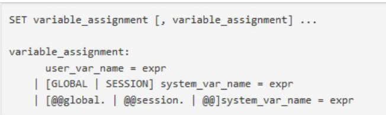

# Variables i opcions de MySQL
Una de les tasques més importants de l'administrador del SGBD és conèixer el conjunt de variables del servidor i les seues respectives opcions per realitzar un ajustament òptim d'elles. Es poden establir les opcions d'aquestes variables al fitxer **my.cnf** (Linux) o **my.ini** (Windows), en la línia de comandaments o mitjançat les variables amb el comandament **SET**.

Les opcions en la línia de comandaments tenen precedència sobre els valors especificats al fitxer de configuració i les variables d'entorn. Els valors especificats al fitxer de configuració té preferència sobre les de les variables d'entorn.

Les opcions especificades a l'arxiu de configuració es carreguen quan arranca el servidor i són permanents. És el mètode més utilitzat.

## Arxiu de configuració
L'arxiu **/etc/my.cnf** (o **/etc/mysql/my.cnf**) permet la configuració permanent de les opcions. També poden configurar-se paràmetres específic per a un usuari concret a **~/.my.cnf**.

L'arxiu de configuració està organitzat en seccions:

- **\[mysqld\]**: opcions del servidor mysql.
- **\[mysql\]**: opcions del client en text mysql.
- **\[mysqldump\]**: opcions de mysqldump.
- **\[client\]**: agrupa opcions per a diversos clients: mysql, mysqldump, mysqladmin...

## Opcions en línia de comandaments
Encara que normalment arrencarem el servei amb **systemctl**, es pot fer-ho també de manera manual passant paràmetres de configuració com al següent exemple:

    mysqld --skip-grant-tables --console

Aquest exemple arrencaria el servei de MySQL sense taula de permisos i enviant a consola els missatges.

No es recomana aquest mètode d'arrencar el servei mes que en casos puntuals.

## Tipus de variables
Les variables a MySQL poden ser de tipus:

- **Dinàmiques - estàtiques**: segons si són modificables o no en temps d'execució.
- **Globals - de sessió**: segons si afecten totes les connexións o només a un client en particular.
- **D'estat - de sistema**: segons si es refereix a l'estat del servidor en un moment donat o al seu comportament general.

## Variables de sistema
Les variables de sistema del servidor són aquelles que ens determinaran el funcionament del nostre servidor.

Per obtindre una llista de les variables del servidor, podem executar la instrucció:

    mysqld --verbose --help

Es pot consultar el [manual](https://dev.mysql.com/doc/refman/9.7/en/server-system-variable-reference.html) per saber tota la informació d'una variable (fitxer d'opcions, domini, SET, abast, dinàmica, valor per defecte,...).

Algunes variables de sistema importants són:

- **bind_address**: direcció IP del servidor quan en té més d'una.
- **read_buffer_size**: grandària del buffer de lectura utilitzat a distints motors d'emmagatzematge (no a InnoDB),
- **join_buffer_size**: grandària del buffer quan es realitzen joins amb taules sense índexs.
- **max_connections**: nombre màxim de connexions
- **thread_cache_size**: memòria cau de threads

## Variables d'estat
Són variables què ofereixen informació sobre l'estat del servidor. Es pot consultar el llistat complet de variables d'estat al següent [enllaç](https://dev.mysql.com/doc/refman/9.7/en/server-status-variable-reference.html).

Algunes variables d'estat importants són:

- **Uptime**: nombre de segons que el servidor ha estat funcionant ininterrompudament.
- **Max_used_connections**: nombre màxim de connexions simultànies des de que es va arrencar el servidor.
- **Queries**: nombre de sentències executades pel servidor.
- **Aborted_clients**: nombre de connexions que han sigut abortades perquè el client ha mort sense tancar la connexió correctament.
- **Aborted_connects**: nombre d'intents fallits de connexió al servidor.
- **Threads_connected**: nombre de connexions actualment obertes.
- **Slow_queries**: nombre de consultes que han tardat més temps que la variable de sistema **slow_launch_time**

## Comandaments per gestionar variables
Només podem fer dos operacions sobre les variables: mostrar el seu valor amb el comandament **SHOW** i modificar-lo amb el comandament **SET** (només les variables dinàmiques i definides per l'usuari).

A continuació, coment les opcions més utilitzades del comandament **SHOW**:

- **SHOW ERRORS**: mostra els missatges d'error del servidor.
- **SHOW WARNINGS**: mostra els missatges d'error i d'advertència.
- **SHOW VARIABLES**: mostra les variables de sistema i el seu valor.
- **SHOW STATUS**: mostra les variables d'estat i el seu valor.
- **SHOW BINARY LOGS**: mostra el llistat de fitxers log binaris i la seua grandària del servidor.

Per consultar el valor d'una variable en concret podem fer ús de la següent sintaxi:

    SHOW [GLOBAL | SESSION] VARIABLES [LIKE 'pattern' | WHERE expr]
    SHOW [GLOBAL | SESSION] STATUS [LIKE 'pattern' | WHERE expr]

El comandament SET s'utilitza per establir les variables dinàmiques i definides per l'usuari. Els canvis realitzats no són persistents. Reiniciar el servidor o el client, depèn de l'àmbit farà que es reprenguen els valors de l'arxiu de configuració.

Es pot persistir els canvis amb la instrucció **SET PERSIST**, guardant-se les dades a l'arxiu **datadir/mysqld-auto.cnf**.

<figure style="align: center;">
    
    <figcaption>Comandament SET</figcaption>
</figure>

Exemples:

    SET sort_buffer_size = 10 * 1024 * 1024;
    SET GLOBAL sort_buffer_size = 10485760; # canvi per a tots
    SET SESSION sort_buffer_size = 20971520; # canvi per a aquesta sessió

## Exercici
Criteris d'avaluació 2a, 2f, 2g, 2h.

- Canvia el port per defecte pel que s'accedeix al servei de mysql. Quin és el port per defecte?. Per què seria útil canviar el port?
- Consulta el criteri d'avaluació 2g a la portada del materials i estableix el valor a 2 variables del servidor relacionades amb aquest criteri.
- Per què serveix l'opció **bind-address**? Com la utilitzariem per augmentar la seguretat de la nostra instal·lació?
- I l'opció **local-infile**? 
- Al següent [enllaç](https://www.tutorialspoint.com/mysql/mysql_load_data.htm) pots consultar com podem carregar dades a una taula mitjançant el comandament **LOAD DATA**. Crea una BD anomenada **prova**. A ella crea una taula de la teua invenció amb 3 atributs. Crea amb ChatGPT o similar un arxiu **csv** que continga dades d'exemple aleatoris per aquesta taula. Carrega l'arxiu amb el comandament LOAD DATA. Abans de carregar les dades comprova el valor de la variable de sistema **secure_file_priv** i estableix el seu valor perquè només es puguen carregar les dades des d'un directori concret.
